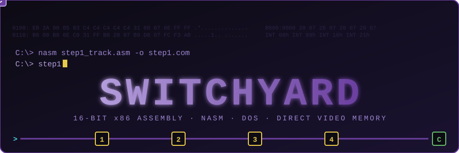

<div align="center">

[](assets/banner.svg)

**A railway switching puzzle written in raw 16-bit x86 assembly.**
**Flip the switches. Route the trains. Don't crash into the wrong station.**

[](#-tech-stack)
[](#-tech-stack)
[](#-tech-stack)
[](#-quick-start)

[](#-acknowledgements)
[](#-acknowledgements)
[](#-roadmap)

</div>

---

## 🚂 The Idea

Trains roll in from two entrances. Each one carries a **letter**: the station it wants to reach. Between the entrances and the stations sit **four switches**, and you are the only one who can flip them.

Send a train to the right station and you score. Send it to the wrong one and that is a **mistake**. Five mistakes and it is game over.

```
   Entry 1 ──► [1] ──► A                      Every switch has exactly two routes.
                 ╲                            Flip it at the right moment and the
                  ╲──► shared track ──► B     train follows the new route.
                  ╱         [3] ──► [4] ──► C
   Entry 2 ──► [2] ──► D                      Flip it at the wrong moment and
                                              your C train ends up at B.
```

No game engine. No libraries. No `printf`. Just registers, interrupts, and **video memory at `0xB800`**.

---

## 🎮 How to Play

| Mode | Who | Keys |
| ---- | --- | ---- |
| 🧍 **Single player** | One person | `1` `2` `3` `4` toggle switches 1 to 4 |
| 🤝 **Two-player co-op** | Player 1 | `1` `2` toggle switches 1 and 2 |
| 🤝 **Two-player co-op** | Player 2 | `J` `K` toggle switches 3 and 4 |

| Rule | Single | Co-op |
| ---- | :----: | :---: |
| ⭐ Score a point | train reaches its **own** letter | same |
| ❌ Mistake | train reaches the **wrong** station | same (shared) |
| ⚡ One-time speed-up | at **6** deliveries | at **12** deliveries |
| 🏆 Win | **10** deliveries | **20** deliveries |
| 💀 Lose | **5** mistakes | **5** mistakes |

> A train that has to wait for another train to clear the track costs you **nothing**. Only reaching the wrong station counts as a mistake.

### 🧠 Example playthrough

A **C** train is approaching switch 1, and a **B** train is already ahead of it on the shared track.

1. Set switch 1 to send **C** onto the shared track.
2. Keep switch 3 pointed toward **B** until the B train takes that branch.
3. Once B has passed switch 3, flip it so **C** continues to switch 4.
4. Set switch 4 toward station **C**. Both trains arrive, score goes up by **2**.

Flip switch 3 *before* B turns and B takes the wrong route. Flip it *after* C turns and C goes to station B.

---

## ✨ Features

| | Feature | Status |
| --- | ------- | :----: |
| 🗺️ | Fixed track drawn from a node table (entrances, 4 switches, 5 station endpoints) | ✅ done |
| 🎨 | Colour-coded cells: track, switches, stations, entrances | ✅ done |
| ⏱️ | Timer interrupt (`INT 08h`) tick counter | 🛠️ next |
| ⌨️ | Keyboard interrupt (`INT 09h`) switch toggling | 🛠️ next |
| 🚆 | Trains with random destinations, spawned only at free entrances | 🛠️ planned |
| 🚧 | Collision-free movement (one claim per cell per update) | 🛠️ planned |
| 🏁 | Score, mistakes and elapsed time on screen | 🛠️ planned |
| ⚡ | One-time speed-up (halve every train's interval, minimum 1 tick) | 🛠️ planned |
| 🤝 | Main menu with single-player and co-op | 🛠️ planned |
| 🔁 | Win, lose, replay or exit, with interrupt vectors restored | 🛠️ planned |

---

## 🗺️ The Track

This is exactly what Step 1 draws on screen (rows 3 to 13):

```
        ┌───────────────────────────────────────────A
        │
   ►────1               ┌───────────────────────────B
        │               │
        │               │
        ├───────────────3───────────────4───────────C
        │                               │
        │                               └───────────D
   ►────2
        │
        └───────────────────────────────────────────D
```

| Switch | State 0 | State 1 |
| :----: | ------- | ------- |
| **1** | straight up to **A** (direct route) | down to the shared track |
| **2** | straight down to **D** (direct route) | up to the shared track |
| **3** | up to **B** | on to switch 4 |
| **4** | straight on to **C** | down to **D** |

Both endpoints marked **D** count as station D. Entry 1 can reach `A B C D`. Entry 2 can reach `B C D`.

---

## 🧱 The Track Table

The whole game walks over **one table of 198 nodes**. Every cell of track is 8 bytes:

```
   one node = 8 bytes
   ┌─────┬─────┬──────┬──────┬───────┬───────┬──────────┬────────┐
   │ row │ col │ char │ type │ next0 │ next1 │ switchID │ letter │
   │ +0  │ +1  │  +2  │  +3  │  +4   │  +5   │    +6    │   +7   │
   └─────┴─────┴──────┴──────┴───────┴───────┴──────────┴────────┘

   type   0 normal   1 switch   2 station   3 entrance
   next0  node to enter next (switch in state 0)
   next1  node to enter when the switch is in state 1 (0xff = none)
```

A real row from the source:

```nasm
db   5,  8, '1' , 1, 6   , 52  , 0   , 0    ;  5: switch 1: 0->A (up), 1->shared (down)
```

> Read it as: *draw a `1` at row 5, column 8. It is a switch. State 0 sends the train to node 6 (up towards A), state 1 sends it to node 52 (down the shared track).*

Moving a train is just: **look up the node, pick `next0` or `next1`, repeat.** The same table also draws the screen.

Screen address of any cell: `offset = (row * 80 + col) * 2`, with `ES = 0xB800`.

---

## ⚙️ How It Will Work

```
        ┌───────────────┐                          ┌───────────────┐
        │  IRQ0 (timer) │                          │ IRQ1 (keyboard)│
        └───────┬───────┘                          └───────┬───────┘
                ▼                                          ▼
      ┌──────────────────┐                      ┌────────────────────┐
      │ INT 08h  our ISR │                      │  INT 09h  our ISR  │
      │ tickcount++      │                      │  in al, 0x60       │
      │ EOI, iret        │                      │  flip switchstate  │
      └────────┬─────────┘                      │  chain old ISR     │
               │                                └─────────┬──────────┘
               └──────────────┐        ┌──────────────────┘
                              ▼        ▼
                    ┌──────────────────────────┐
                    │        MAIN LOOP         │
                    │  spawn → move → draw     │
                    │  score → win/lose check  │
                    └────────────┬─────────────┘
                                 ▼
                      VIDEO MEMORY  0xB800:0000
```

**The collision rule** (the heart of the movement update):

```
   a train may enter a cell only if
        1. the cell was EMPTY at the start of the update, and
        2. no other train has CLAIMED it during this update.

   two trains want the same cell?  one goes, the other waits one update.
```

---

## 🧰 Tech Stack

| Layer | Tools |
| ----- | ----- |
| **Language** | 16-bit x86 assembly (8086 instruction set) |
| **Assembler** | NASM, output as a flat `.COM` file with `[org 0x0100]` |
| **Runtime** | MS-DOS / DOSBox |
| **Display** | 80x25 text mode, direct writes to video memory `0xB800` |
| **Interrupts** | Hooking `INT 08h` (timer) and `INT 09h` (keyboard) by patching the IVT |
| **BIOS / DOS** | `INT 16h` keyboard wait, `INT 21h` terminate |
| **Style** | Stack-passed parameters, every subroutine saves and restores its registers |

---

## 🚀 Quick Start

### 1. Assemble

```
nasm train.asm -o train.com
```

### 2. Run in DOSBox

```
mount c C:\path\to\SwitchYard
c:
step1
```

### 3. What you will see

The screen clears and the full track appears. Track lines are **grey**, switch numbers `1 2 3 4` are **yellow**, stations are **green**, and the two entrance arrows are **cyan**. Press any key to return to DOS.

---

## 📁 Project Structure

```
SwitchYard/
├── assets/
│   └── banner.svg          animated README banner
├── train.asm         track table + clrscr + drawtrack
└── README.md
```

---

## 📊 Roadmap

```
   [■■■■■■■■■■]  Step 1   Track table and screen drawing
   [□□□□□□□□□□]  Step 2   Timer ISR (INT 08h) and tick counter
   [□□□□□□□□□□]  Step 3   Keyboard ISR (INT 09h) and switch toggling
   [□□□□□□□□□□]  Step 4   Trains: spawn, random destination, movement
   [□□□□□□□□□□]  Step 5   Collision rule (occupied + claimed)
   [□□□□□□□□□□]  Step 6   Score, mistakes, elapsed time
   [□□□□□□□□□□]  Step 7   One-time speed-up
   [□□□□□□□□□□]  Step 8   Main menu and co-op keys
   [□□□□□□□□□□]  Step 9   Win, lose, replay, restore interrupt vectors
```

---

## 🙏 Acknowledgements

- **Assembly Language Programming** lecture notes (CS401, Virtual University of Pakistan), the book and style this whole project follows
- **Sir Belal Hashmi**, for teaching the course
- **NASM** and **DOSBox**, for making 16-bit code fun again

---

### 👩‍💻 Author

| Role | Name |
| ---- | ---- |
| Developer | Eman Fatima ([@l253010](https://github.com/l253010)) |
| Developer | Amna Azeem ([@amnaazeem-code](https://github.com/amnaazeem-code)) |


```
        ┌────────────────────────────────────────────────┐
        │   mov ax, 0x4c00     ; see you at the next     │
        │   int 0x21           ; switch. return to DOS   │
        └────────────────────────────────────────────────┘
```

**Built for Assembly Language, BSSE 3B, Fall 2026** 🚂
